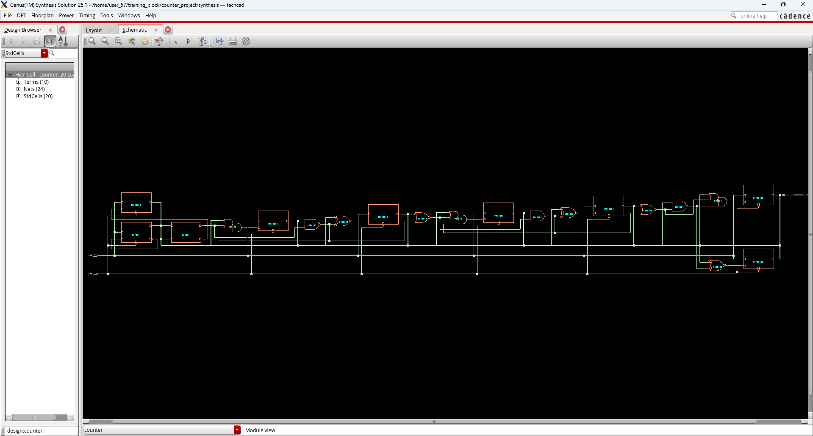
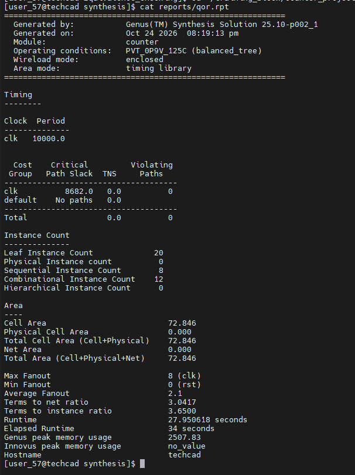
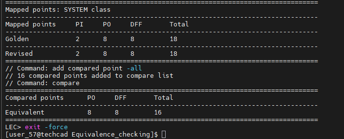

# 8-bit Counter: RTL to Gate-Level Netlist with Cadence Genus and Conformal LEC

Hands-on ASIC front-end flow on an 8-bit up-counter, done on a Cadence server as
part of my VLSI Physical Design training. The design is taken from **RTL** to a
**verified gate-level netlist** on a **45 nm standard-cell library**
(gsclib045, slow corner 0.9 V / 125 °C), using industry tools:

| Step | Tool | Result |
|---|---|---|
| RTL design | Verilog | 8-bit counter, async active-low reset |
| Timing constraints | SDC | 100 MHz clock, I/O delays, clock transition and uncertainty |
| Logic synthesis | **Cadence Genus 25.1** | 20 cells, 72.846 µm², +8.68 ns slack |
| Effort-level study | Genus + Tcl script | Compared low / medium / high effort (PPA trade-off) |
| Equivalence check | **Cadence Conformal LEC 25.2** | 16 / 16 compare points **equivalent** |

## Design

An 8-bit synchronous up-counter (`counter`): ports `clk`, `rst` (asynchronous,
active-low) and `count[7:0]`. On every rising clock edge `count` increases by 1,
wrapping from 255 to 0, and `rst = 0` clears it immediately.

The circuit is 8 D flip-flops (memory) and an 8-bit "+1" incrementer, built from a
half-adder carry chain, that feeds the flops' D inputs.

> The counter RTL, testbench and SDC come from the Cadence "RTL to GDSII" course
> database (Cadence Educational Services). The scripts, reports, screenshots and
> analysis are my own work.

Synthesized netlist in the Genus schematic viewer (20 standard cells):



## Constraints (`constraints/constraints_top.sdc`)

- Clock `clk`: period 10 ns (100 MHz), 50 % duty cycle
- Clock transition 0.1 ns, clock uncertainty 0.01 ns
- Input delay 1.0 ns on `rst`, output delay 1.0 ns on `count`

## Synthesis flow (Genus)

`read_libs` → `read_hdl` → `elaborate` → `read_sdc` → `syn_generic` → `syn_map` → `syn_opt` → reports and netlist.
Everything was first run interactively, command by command, and then automated
in a Tcl script (`synthesis/run_synth.tcl`).

### Results (medium effort)

| Metric | Value |
|---|---|
| Clock | 10 ns (100 MHz) |
| Worst slack (WNS) | **+8682 ps** (reg → output path) |
| Reg → reg slack (through the adder) | +8866 ps (data path 1032 ps, 7 logic levels) |
| Violating paths / TNS | 0 / 0 |
| Cells | 20 (8 sequential + 12 combinational) |
| Area | 72.846 µm² (flip-flops = 68.5 %) |
| Power (vectorless estimate) | 2.755 µW (internal 93 %, switching 6.9 %, leakage 0.06 %) |



Cells used: `ADDHX1` (half adder), `DFFRHQX1` ×7, `DFFRX1` ×1, `NAND2X1` ×3,
`NOR2BX1` ×2, `OA21X1` ×3, `XNOR2X1` ×3.

What I observed:
- `elaborate` produced generic gates and Cadence generic flops (`CDN_flop`).
  `syn_map` replaced them with real library cells: instances went from 34 to 20,
  and area from 141 to 72 µm².
- `syn_opt` applied `rem_inv_qb`: a flip-flop plus inverter was replaced by one
  flop with a QN output (`DFFRX1`).
- The worst path is **reg → output**, not the longer reg → reg adder path,
  because the 1 ns output delay tightens the reg → output deadline more than the
  adder's extra delay matters.

### Effort-level study (low vs medium vs high)

| Metric | low | medium | high |
|---|---|---|---|
| Worst slack | **+8712 ps** | +8682 ps | +8682 ps |
| Area | **72.504 µm²** | 72.846 µm² | 72.846 µm² |
| Power | 2.821 µW | **2.755 µW** | **2.755 µW** |
| Cell count | 22 | **20** | **20** |
| Runtime | 33 s | 33 s | 34 s |

Findings:
1. **No effort level won on every metric.** Low effort built the adder from more
   but smaller cells (`AND2XL`, `AOI2BB1XL`): slightly smaller area and better
   slack, but **2.4 % more power** and 2 more cells. This is a small example of
   the PPA (power, performance, area) trade-off.
2. **Medium and high gave identical results.** On a small design with an easy
   clock, high effort only costs runtime.
3. The `rem_inv_qb` optimization (used at medium/high) saved one cell but **no
   area**: the QN flop is exactly as large as a Q-only flop plus an inverter
   (49.932 µm² either way).
4. Netlist file size is misleading (the low netlist file was 46 % larger), so
   conclusions should come from the timing, area and power reports.

## Logic Equivalence Check (Conformal LEC)

Golden = the RTL (`counter.v`), revised = the Genus netlist (`counter_netlist.v`).

```
Mapped points     PI     PO     DFF       Total
Golden            2      8      8         18
Revised           2      8      8         18

Compared points      PO     DFF       Total
Equivalent           8      8         16
```


All 18 key points mapped, and all 16 compare points are **equivalent**: the netlist
is formally proven to match the RTL.

## Debugging notes from the server setup
- **Licence:** `lec -XL` failed (no `Conformal_Ultra` licence). I used `lmstat -a` to
  list the licences on the server, found `Conformal_Low_Power_GXL`, and ran
  `lec -lpgxl`.
- **Tool paths:** Xcelium and Tempus were referenced in `.cshrc` but not installed
  (`xce_23`, `ssv_221` missing), so RTL simulation and Tempus STA were not possible
  on this server. Timing was analysed in Genus.
- **Library names are case-sensitive:** `slow_vdd1v0_basicCells.lib` vs `slow_vdd1v0_basiccells.v`.
- **QoR "Min fanout 0 (rst)":** checked with `grep` that `rst` drives all 8 flop
  reset pins. Genus doesn't count async reset pins in this fanout figure.

## Repository layout
```
rtl/                            counter.v, counter_test.v
constraints/                    constraints_top.sdc
synthesis/outputs/              generic, mapped and final netlists, sdc, sdf
synthesis/run_synth.tcl         full Genus flow (interactive steps turned into a script)
synthesis/run_effort.tcl        same flow with a Tcl variable for low / medium / high effort
synthesis/reports/              timing, area, gates, power, qor (medium effort)
synthesis/reports_low|medium|high/   reports from the effort study
Equivalence_checking/counter.do      Conformal LEC dofile
Equivalence_checking/counter_lec.log LEC log
docs/                           screenshots
```

## How to run
```bash
csh                                   # load the Cadence environment
cd synthesis
genus -log logs/genus -files run_synth.tcl
cd ../Equivalence_checking
lec -lpgxl -nogui -dofile counter.do
```
The scripts expect a `../lib` folder with the gsclib045 libraries (not included).

## Next steps
- Physical design of the same netlist in Innovus (floorplan, placement, CTS, routing)
- RTL and gate-level simulation once Xcelium is available
- DFT (scan insertion) and LEC of the scan netlist

*Tools: Cadence Genus 25.1, Cadence Conformal 25.2. Library: Cadence gsclib045 (not included in this repository).*
